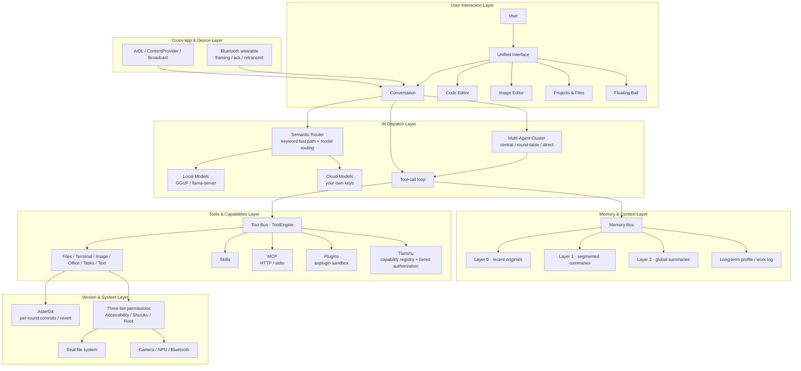

<div align="center">

# Anulus

**The AI hub of your Android phone — one AI assistant that actually operates your apps, files, tools, and devices.**

**Possibly the most powerful AI agent on Android — today, and built for what comes next.**

[](CHANGELOG.md)
[](#requirements)
[](#requirements)
[](#requirements)
[](LICENSE.md)
[](PRIVACY.md)

[Download](#download) · [Install guide](docs/INSTALL.md) · [Verify your download](docs/VERIFY.md) · [FAQ](docs/FAQ.md) · [Privacy](PRIVACY.md)

**[简体中文说明 →](README.zh-CN.md)**

</div>

---

## What is Anulus

Anulus is the **AI hub of your Android phone** — far more than a chat interface. It is a unified platform where an AI assistant sits at the center of a suite of on-device tools — office documents, image editing, file management, project boards, notes, and small utilities — and can **directly operate them** through a local tool bus, with no cloud relay required.

Unlike most AI apps that are thin chat wrappers around cloud APIs, Anulus is built so the assistant **actually operates your phone's real tools** — documents, images, files, and projects — through a local tool bus, instead of leaving you to copy-paste between apps. How it runs is pragmatic: cloud models use your own keys and endpoints, and a fully offline on-device engine is there when you want it; either way your data stays on your device.

The app is built with **Tauri 2.0**, combining a native Android shell with a web-based UI layer, delivering a responsive experience while maintaining full access to device capabilities.

**Built-in depth that grows with you.** Anulus ships with a 35+ tool system across 9+ capability domains, and — unlike most mobile AI apps — it bundles a **real development runtime**: a self-extracting Termux base system with Python and Node.js plus a Bash shell, unpacked into app storage on first use. You get a full Linux execution environment out of the box, then extend it your way with `pkg install` from official sources or by dropping a `.deb` for offline install. Lightweight layers (BusyBox 300+ commands, Android Shell) carry the everyday load with near-zero extra memory, and the heavy runtime stays off until you call it — so startup stays lean. The ceiling is set by you, not by us. System-level access (Shizuku/Root) stays strictly opt-in for those who need it. Automation and deeper system capabilities remain firmly on our roadmap — they take long-term refinement to build right, and restraint like skipping blind screen-tapping is a compliance choice for the long haul, not a lack of ambition.

---

## The AI Baseline

> **Let's be blunt.** Strictly speaking, none of what follows counts as an "advantage." But most people judge an AI product on exactly these things first; stay silent and you hand over the narrative, only to be written off with "it doesn't even have this." So this section is neither modest nor evasive: it exists to prove we *do* have these, and to state how each is implemented. Whether they're any good cannot be argued in words — install it and see for yourself.

| Baseline capability | Present | How it's implemented (brief) |
| --- | --- | --- |
| Local models | Yes | GGUF models + llama.cpp's `llama-server`, running inside the in-app Termux runtime, exposed to the app as an OpenAI-compatible localhost endpoint |
| MCP | Yes | Stateless Streamable HTTP plus local stdio; tools, resources, and prompts all register into the unified tool bus |
| Memory Box | Yes | 4 data classes, 3 context layers, 5 write-back states; originals expire but are never physically deleted |
| Built-in Git | Yes | AsterGit, a pure-Rust mini-git producing standard git objects; commits per conversation round, with history, diff, revert, single-file restore, and checkpoints |
| Context handling | Yes | Tiered compression at 60% / 85% of the model budget; summaries replace originals in requests while the originals stay intact in the conversation |

### Local Models

Model management happens in the backend: download GGUF files from HuggingFace mirrors or import them manually, list, delete, and mark them as text or image models. Inference is handed to `llama-server` inside the in-app Termux runtime, which opens an **OpenAI-compatible endpoint** on `localhost` that the existing streaming chat infrastructure then reuses.

Once a model file is downloaded, inference needs no network at all. Text and image models are both supported; actual speed depends on your device, model size, and quantization level — not on marketing copy. Model directory, downloads, imports, and deletions all happen in-app and never touch our servers.

### MCP

Yes — and not just "one example server."

- **Remote HTTP**: stateless Streamable HTTP per the MCP `2026-07-28` spec — each request is an independent POST, with no `initialize` handshake and no `Mcp-Session-Id`; the method travels in the `Mcp-Method` header and the tool name in `Mcp-Name`, and responses may be a single JSON object or a request-scoped SSE stream.
- **Local stdio**: supports official-ecosystem servers in `npx` / `python -m` form. Processes are lazily spawned through the bundled Termux runtime — the app does not pre-start them; each server gets its own process, requests are routed by auto-incrementing id and may be awaited concurrently, output writes are serialized behind a lock, and stop kills the whole group.
- **Surface**: tools, resources, and prompts all register into the unified tool bus and can be enabled or disabled per context; server configuration is encrypted to disk with AES-256-CBC, remote servers must be HTTPS (local `localhost` excepted), tokens never reach logs, calls time out at 60 seconds, listing at 20 seconds, and response bodies are truncated at 512 KB.

MCP is an **extension channel** in our design, not a core capability. The core remains the local tool bus; MCP lets standard external tools plug in, but how good those external servers are is up to their authors.

### Memory Box: 4 Data Classes, 3 Context Layers

"Memory Box" is not a slogan that "we have long-term memory." It splits data into **4 classes** and context into **3 layers**.

**4 data classes:**

1. `context` — per-conversation context, scoped to `conv:<id>`;
2. `summary` — per-conversation summaries, also in the conversation scope;
3. `memory` — the AI's own overall memory, scoped to `actor:index`, `actor:agent:<id>`, and `actor:subject:<id>`;
4. `log` — the AI's work log, never auto-injected; only the AI can read it by explicitly calling the log tool.

**3 context layers:**

- **Layer 0: recent originals**, sent directly within budget;
- **Layer 1: segmented summaries**, produced by compression once a conversation exceeds budget; every 6 of them merge into Layer 2;
- **Layer 2: global summaries**, the long-range summary merged from Layer 1; old entries are only marked expired, never deleted, and remain traceable.

**How it's assembled:**

- Retrieval follows "current conversation scope → current actor scope → shared scope", or the caller may specify a full chain;
- Ranking uses **effective importance = raw importance × decay factor**, further weighted by recall history (`lastHitAt` / `hitCount`); a slot is reserved for vector-based supplemental recall;
- Write-back is a **5-state decision**: `add / update / replace / close / restore`, plus a safety-valve `decay`. `close` requires four conditions at once — miss one and it downgrades to `decay`; at most 2 entries are closed per round by default; entries still within their validity window are never closed; nothing is ever physically deleted;
- Long-term memory is not stuffed wholesale into the system prompt; it is merged in from the tail of the context at the last moment before sending. When the AI can't recall something, it can fetch it itself via `memoryRead` by keyword (`topK` 20, budget 1200 tokens; when there are zero keyword hits it does *not* fall back to "the most recent few", so unrelated memories aren't presented as fact);
- Recall-hit write-back is throttled to disk on a 30-second window, with a forced flush when the page is hidden or the app exits.

This is **heuristic organization**, not precise database retrieval: it can miss, conflict, or be unsure. When unsure, it lowers weight instead of deleting — that is a design choice, not a capability gap.

### Built-in Git: AsterGit

Yes. It does not shell out to `git` in Termux; it is a **pure-Rust mini-git kernel with zero new dependencies**, producing object formats byte-for-byte identical to C git and readable by `git fsck`.

- **Per-round commits**: before each AI round runs file tools it records an anchor, and commits at the end of the round; the commit message carries `Anulus-Conversation` / `Anulus-Round` structured trailers, and the anchor and round hashes are written back into that message's metadata — so "back to before this round" still works after a restart;
- **Revert ≠ delete**: reverting a round applies that round's changes in reverse onto the current HEAD and creates a new commit; the revert itself can be reverted, and history stays true;
- **Conflict handling**: if a file changed in this round was hand-edited before the revert, you get a per-file prompt to "revert anyway / skip this file";
- **The rest**: `status / log / diff / show / commit / revert / restore / checkpoint`; automatic checkpoints before risky operations; `.git` is hidden from the file tree, protected from deletion, and skipped by history scans; `.anulusignore` is independent of `.gitignore` and excludes media, model, and attachment directories by default.

It is explicitly **not a full git client**: no git protocol (push/pull over ssh/https), no merge / rebase / interactive history rewriting, no packfile writing, no submodule / hooks / attributes / CRLF conversion. When you need those, use the real git in Termux or the GitHub API. What we built in is a **version time machine**, not a git client for programmers.

### Context Handling

Context handling is not "truncate to the last N messages."

- Read the context budget for the current model, estimate tokens by character count (a conservative measure), and assemble the request;
- **Layer 0 originals under 60% of budget and not yet compressed**: send originals only, injecting no summaries at all;
- **60%–85%**: originals plus relevantly selected Layer 1 segmented summaries;
- **Above 85%**: originals + Layer 1 + Layer 2 global summaries, with compression carried out by `autoCompressContext`;
- **Topic switch**: when token overlap with the previous user utterance in this round is under 20%, Layer 2 is no longer injected while compression is pending;
- **Reference trigger**: words like "just now / earlier / last time" are treated as an explicit look-back, and all of Layer 1 is selected;
- Tool results are truncated, concurrent sub-tasks inherit the main context (system prompt + last 12 history messages + attachments), and routing results are cached for 60 seconds;
- Originals always remain in the conversation; compression merely substitutes summaries *when sending a request*, it does not delete history.

Honestly: token estimation is heuristic, and a single oversized message can still blow the budget; summary quality depends on the summarization model you configure. It aims to explain the context as clearly as possible, not to guarantee losslessness.

---

## Multi-Agent Cluster

This is not filed under "baseline," because most AI apps genuinely don't have it. It is not the gimmick of "run several models at once" — it's a stateful round-table/scheduling system with roles, memory, and termination conditions.

- **Commander + members**: each member is bound to an API profile (a model) and has its own prompt, tool switches, and memory switches; the commander additionally gets scheduling-directive capability.
- **Three speaking modes**:
  - `command` **central scheduling**: the commander names the next speaker with `【assigned:member】`, and the directive is hidden from displayed content; after 2 consecutive failed assignments it auto-rotates to the next member and notifies the user;
  - `auto` **round-table rotation**: rotates through members in order, with `concurrentCount` letting several members speak in parallel in batches;
  - `user` **direct assignment**: the user names one member to speak once, no looping, waiting for the next user message.
- **Per-conversation override**: the same cluster can use a different mode in each conversation without writing back to the cluster config or locking other conversations.
- **Cross-conversation memory**: once a cluster is bound, member memories are written to the cluster store and accumulate across conversations keyed by a stable member key; older conversations fall back to in-session memory. Both the leader and members can turn memory off individually.
- **Termination and fallbacks**: `maxMessages` round caps, an `endSymbol` consensus marker (any member triggering it ends the session), `memberTimeout` (90 seconds by default), an `autoSummary` produced by a chosen profile after the session ends, and tool feedback fed back according to the mode.
- **State machine on the Rust side**: `cluster_start` / `cluster_turn_done` / `cluster_abort` drive advancement, completion, and abort; the frontend only renders and routes the user.
- **Paired concurrency engine**: `parallel / sequential / hybrid` strategies; merge strategies `concat`, `best_of`, `vote`, and `weighted_vote`; a default 60-second per-profile timeout, a maximum of 5 in parallel, and 5-minute result caching; sub-tasks inherit the main context by default (system prompt + last 12 history messages + attachments).

It has costs, of course: more tokens, more time; the commander can fail to schedule; the summary itself is another model call; and cluster conversations cannot bind a project under current constraints. We call it out separately because **the orchestration logic itself** is what most products lack — not because it's free or universal.

---

## Architecture Overview

Anulus's architecture is designed around a **local tool bus** pattern:



**Core architectural layers:**

| Layer | Technology | Role |
| --- | --- | --- |
| UI Layer | HTML/CSS/JS (WebView) | Renders all interfaces, supports theming |
| Tool Bus | Rust (Tauri 2.0 commands) + JS ToolEngine | Mediates all tool calls, handles file I/O, manages state |
| AI Engine | On-device inference + cloud proxy + semantic routing | Runs inference, routes tool calls, manages conversation context |
| Memory Layer | Rust memory_box + JS memory-layers | Assembles context, tiered summaries, long-term memory, write-back decisions |
| Version Layer | Rust AsterGit | Real git objects, per-round commits, history and revert |
| Plugin System | Isolated WebView (axplugin://) | Sandboxed third-party extensions with a permission model |
| Device Bridge | Android JNI + Bluetooth/WiFi | Connects to wearables, phones, and other devices |

---

## Key Features

### Built-in Tool System — 35+ tools, 9+ capability domains

The AI doesn't just chat — it can **actually operate your phone** through a 35+ built-in tool system, grouped into capability domains:

- **Web & Information**: live web search with on-device result filtering; search *inside* files (grep-style content search) and by filename; read chat attachments; extract audio from video.
- **File Operations**: create, edit (full-file and line-level), read, list, delete, rename, and move **real files on your device** — the AI works on your actual storage, not a sandbox copy.
- **Terminal & Execution**: a full terminal over three layers — BusyBox (300+ commands), Android Shell, and the bundled Termux runtime (Python + Node.js + Bash); run Python scripts and shell commands directly.
- **Version Control**: AsterGit auto-commits per conversation round, with history, diff, revert, single-file restore, and checkpoints before risky operations.
- **Multi-Agent Concurrency**: dispatch several AIs in parallel and schedule multiple tools to run at once, then merge the results.
- **Image**: on-device photo editing (filters & adjustments, no upload) and AI image generation.
- **Tasks & Schedule**: build structured task plans (create / add / update), set reminders that fire on the system alarm manager and can auto-run an AI step, and generate structured question cards.
- **Text & Encoding**: base64, hash, timestamp, UUID, password generation, JSON formatting, encode across 10+ formats, JWT, regex, text layout, text coloring, and feedback capture.
- **MemoryBox (on-device AI memory)**: the assistant's memory layer — it assembles per-conversation context, conversation summaries, and a long-term profile of you, ranks what's relevant, and writes new facts back with conflict-aware logic (merge / replace / decay / restore). Your history never leaves the device.
- **MCP**: connect external tool servers that speak the MCP protocol (HTTP and stdio transports).
- **Plugin System**: call third-party plugins.
- **Tianshu**: a capability registry with tiered authorization (L0 executes directly / L1 and L2 require confirmation), lazy per-group expansion of settings and plugin capabilities, and pre/post values logged for every execution with undo support.

This is the deepest on-device tooling available to an AI agent on Android — your assistant can search the web, write code, edit files, run terminals, and orchestrate multiple AI models in parallel, all on your phone.

### AI Assistant
- Works with any cloud AI provider you configure (OpenAI-compatible APIs, local inference endpoints)
- **Fully offline on-device engine** — download a model once, run inference locally with no network
- Semantic routing: keyword fast path plus offline/online model routing, selecting the right profile for each task
- Concurrent multi-AI orchestration: dispatch sub-tasks to different models in parallel
- Context compression, memory management, and long-term recall

### Office Suite
- **Documents**: Rich text editing with Markdown support, rendered with KaTeX math and Mermaid diagrams
- **Tables**: Spreadsheet functionality with formulas and formatting
- **Notes**: Quick capture with media attachments
- **Text utilities**: OCR, format conversion, encoding/decoding tools
- **File conversion**: Between common document formats

### Image Editor
- On-device image editing with filters, adjustments, and effects
- Layout tools, crop, rotate, and export
- Project-based photo organization with galleries
- Supports common image formats

### File & Project Management
- Full file manager with breadcrumb navigation
- Project boards with per-day working files
- Folder and file operations (create, rename, move, delete)
- Multi-level directory tree with collapse/expand
- Built-in archive and backup support

### Terminal & Developer Tools
- **A real, bundled development runtime.** A self-extracting Termux base system with **Python and Node.js plus a Bash shell** ships inside the app and unpacks into app storage on first use — you get a full Linux execution environment out of the box.
- **Self-configurable, easy to extend.** Grow it your way: `pkg install` from Termux's official sources (needs network), or drop a `.deb` package for fully offline installation. You bring your own environment without leaving the app.
- **Light by default.** The everyday layers — BusyBox (300+ commands) and the Android Shell — add almost no extra memory. The heavy Termux runtime stays unpacked-but-idle until you actually run something, so startup stays lean.
- Code editor with syntax highlighting (CodeMirror) and NexusScript reference documentation.

### Utilities
- Voice input with multi-engine support
- QR code scanning
- Floating ball quick-access overlay
- Small games (2048, Go board)
- Scheduled reminders with alarm manager persistence
- Text-to-speech (TTS) with auto-reading
- Fully themeable: a free color palette lets you recolor the entire interface — background, accent, chat bubbles, and more — to your taste.

### Landscape Mode
A dedicated landscape layout for wider screens. Flip a switch in Settings and the whole app rotates to landscape and reorganizes into a persistent left sidebar plus a width-limited main area — built for using the phone with a keyboard, an external display, or simply more room. Orientation is driven **purely by the switch, not by the device's auto-rotate**, so it never triggers by accident in a wide browser or desktop window; a first-frame script applies the layout before paint to avoid a portrait flash.

### Wearable Remote (scope)
Anulus can talk to a wearable over Bluetooth through a reliable, framed transport — automatic segmentation, per-frame acknowledgment, and retransmission on timeout. From the wearable you can control the assistant's status and toggle plugin switches, and any risky command the assistant wants to run is first sent as a **safe-confirmation** request that must be approved on the device before it executes. System-level limit: official wearable firmware does not allow AI message text to be shown on the band, so the wearable controls and confirms rather than displays conversation content.

---

## Feature Integration — and Cooling the Hype

Features are not laid out side by side. Anulus's value is in the chains: one request can pass through tools, memory, version control, clusters, and plugins, and end up as a real file or a real action. If "how well features combine" must be given a coefficient, our formula is simple: **a chain counts as 1 only when it runs end-to-end and its boundaries are stated clearly; stacking features counts as nothing.**

| Combination | What actually happens |
| --- | --- |
| AI + file tools + AsterGit | Every round's changes become a commit tagged with conversation and round; you can "go back to before this round"; reverts create new commits, with conflicts handled per file |
| AI + Memory Box + tiered context | Layer 0 originals, Layer 1 segments, and Layer 2 globals are assembled by budget; long-term memory is injected from the tail; the AI can call `memoryRead` on its own |
| Multi-agent cluster + concurrency engine + tool bus | Members speak in parallel or in turn, tool calls run concurrently, and results merge via `concat / best_of / vote / weighted_vote` |
| AI + MCP + skills + plugins + Tianshu | External tools, skills, and plugins all register into the tool bus, are enabled per context, and are authorized by L0/L1/L2 sensitivity |
| AI + terminal + local models | `llama-server` runs in Termux behind a local `localhost` endpoint, so inference works offline |
| AI + office / image / projects | One request cascades through several tools, and outputs land on the real file system, not sandbox copies |
| Floating ball + AI + Accessibility | Global invocation, screen understanding, semi-automatic operation; critical steps always ask for confirmation, with no blind screen tapping |

A real chain:

1. User: "Turn last week's notes into a project report, add charts, and save it as PDF."
2. The AI locates the notes through file tools (the project files genuinely exist).
3. Office tools compile the document, image tools generate charts, and file tools export the PDF.
4. AsterGit commits at the end of the round; if you're unhappy, you tap "back to before this round" and the revert creates a new commit.
5. The Memory Box writes back this round's facts and preferences; next time a similar task comes up, the AI can recall them by keyword.

**Cooling the hype — things we don't claim.**

- **No fully automatic blind screen tapping.** Floating-ball and Accessibility operation are semi-automatic: screen understanding, highlighting, step-by-step confirmation, and safe-confirmation for risky commands. Skipping blind tapping is a compliance choice, not a capability limit.
- **Local models are not "GPT-4 in your pocket."** They need a capable device and a separately downloaded model file; speed and quality depend on model size, quantization, and hardware — not slogans.
- **Built-in Git is not a full git client.** No protocol, merge, rebase, or packfile writing; use real git in Termux or the GitHub API for those.
- **Memory is not precise database retrieval.** It is heuristic organization that can miss, conflict, or be unsure; when unsure it lowers weight rather than deletes, and it never syncs memories to the cloud.
- **The cluster is not "free extra power."** More tokens, more time; quality depends on member models and commander scheduling; the summary costs another model call; cluster conversations cannot bind a project.
- **MCP is an extension channel, not a core capability.** External servers' availability, latency, and output quality are up to their authors; we provide protocol access, encrypted storage, and timeout/truncation protection.
- **The plugin sandbox is WebView origin isolation plus a permission model, not an OS-level security boundary.** Third-party plugins are still third-party code — judge the source before installing.
- **Multi-device connection is encrypted peer-to-peer.** There is no central server relay, so devices must be on the same network or within Bluetooth range; it is not public-internet cloud sync.

---

## Multi-Device Connectivity

Anulus supports connecting to other devices through multiple channels:

### Bluetooth Devices
- Pair with wearables, smart bands, and IoT devices
- Cross-device control: send commands from your phone, receive sensor data
- Health data integration from connected wearables

### Nearby WiFi
- Discover and connect to devices on the same network
- File sharing between Anulus instances
- Collaborative editing across devices

### Phone-to-Phone
- Direct connection between two Anulus instances
- Shared clipboard and task delegation
- Synchronized AI context across devices

All connections are **encrypted and peer-to-peer**. There is no central server, and your data never passes through a third-party relay.

---

## Privacy & Data Sovereignty

- **No account required.** Core features work without any login or registration.
- **No telemetry.** The app collects no usage statistics, crash reports, or analytics.
- **No data upload.** Your conversations, documents, images, and files stay in local storage.
- **Your AI, your credentials.** If you use a cloud AI provider, requests go directly to the endpoint you configured, under your credentials — never through our infrastructure.
- **Local web service** binds to loopback address only, unreachable from outside the device.
- **MCP configuration** is encrypted to disk with AES-256-CBC; tokens are never logged.
- Full privacy policy: [PRIVACY.md](PRIVACY.md)
- Permission-by-permission breakdown: [docs/PERMISSIONS.md](docs/PERMISSIONS.md)

---

## Plugin System

Anulus features an **open plugin format** that allows third-party developers to extend the app's capabilities. The plugin system is fully open-source and documented in the [anulus-plugin-system](https://github.com/AllyXplore/anulus-plugin-system) repository.

- **Package formats**: `.axext` (plain) and `.axex` (encrypted).
- **Manifest and UI**: plugins declare capabilities and `surfaces` in a manifest; declaring `embedded` renders a standard full-screen page whose header is drawn by the host, so a plugin cannot fake the shell; without it, plugins open in their own window, and older plugins migrate with zero changes.
- **Sandbox isolation**: each plugin runs in its own WebView with a unique origin (`axplugin://<plugin-id>`), preventing cross-plugin data access; embedded entry points may only use relative paths inside the plugin package, rejecting schemes, absolute paths, and `..`.
- **Permission model**: plugins request permissions through Android's native APIs; the host configures and validates them per plugin, and cross-plugin calls are denied by default.
- **Resource management**: inactive plugins are unloaded to prevent memory leaks; closing a page first sends `surface_destroy`, and the iframe is destroyed after the exit animation ends.
- **Lifecycle**: plugins load on demand and release when unused.
- **Tool bus**: plugin-exposed tools register into the unified tool bus; Tianshu groups plugin tools automatically as "plugin · name" and invokes them through a unified envelope.
- **Plugin AI endpoint**: a plugin can register its own AI endpoint, which appears in the model selector labeled with its source plugin; requests are sent back to the plugin through a hidden iframe, the host never stores endpoints or keys, and a single request times out at 180 seconds with a 3-second heartbeat for liveness.

The plugin format specification, packaging CLI (`axbuild`), and complete documentation are open-source at [github.com/AllyXplore/anulus-plugin-system](https://github.com/AllyXplore/anulus-plugin-system).

---

## Download

Official releases are published as attachments on the release page below:

| Source | Link |
| --- | --- |
| GitHub | https://github.com/AllyXplore/Anulus/releases/latest |

Installer file name pattern: Anulus-<version>-arm64-v8a.apk

Only files downloaded from the page above are official. Every release lists a SHA-256 checksum and the signing certificate fingerprint — please check them before installing. See [docs/VERIFY.md](docs/VERIFY.md).

---

## Requirements

- **Android**: 7.0 (API level 24) or newer
- **CPU**: 64-bit ARM only (arm64-v8a). 32-bit ARM and x86 are not supported
- **Storage**: ~120 MB for the app itself
- **RAM** (optional, for offline AI engine): 6 GB or more recommended, plus space for downloaded model files

---

## Install & Upgrade

**Install**: Download the APK, allow installation from your browser or file manager when prompted, then open it. Full walkthrough (including "unknown source" prompts on various Android skins) is in **[docs/INSTALL.md](docs/INSTALL.md)**.

**Upgrade**: Install the new version directly over the old one. Do **not** uninstall first — uninstalling removes all local data.

---

## About This Repository

This is the **distribution and documentation** repository for Anulus. It contains:

```
.
├── docs/                 Install guide, verification, permissions, FAQ, release notes template
├── assets/               App icon, screenshots, and documentation assets
├── .github/              GitHub issue templates
├── CHANGELOG.md          Version history
├── CODE_OF_CONDUCT.md    Community guidelines
├── CONTRIBUTING.md       How to contribute (note: code contributions not accepted)
├── LICENSE.md            End-user license agreement, disclaimer, trademark notice
├── PRIVACY.md            Complete privacy policy
├── SECURITY.md           How to report security vulnerabilities
├── SUPPORT.md            Support channels and scope
├── THIRD-PARTY-NOTICES.md  Open-source components and their licenses
├── README.md             This file (English)
└── README.zh-CN.md       Chinese version of this file
```

**The application source code is not published here.** Anulus is proprietary software maintained by a very small team. Third-party open-source components used in the app are credited in [THIRD-PARTY-NOTICES.md](THIRD-PARTY-NOTICES.md).

The plugin format specification, packaging CLI (`axbuild`), and documentation are **open-source** in the [anulus-plugin-system](https://github.com/AllyXplore/anulus-plugin-system) repository.

---

## Feedback & Support

- **Bug reports & feature requests**: [Open an issue](https://github.com/AllyXplore/Anulus/issues/new/choose)
- **Security issues**: Follow [SECURITY.md](SECURITY.md) — do not open a public issue
- **Community**: [QQ Group](https://pd.qq.com/qqweb/qunpro/share?_wv=3&_wwv=128&appChannel=share&attaContentID=7824cc8ef7d54615a238e9f4ee7f38eb&biz=ka&businessType=5&from=246611&inviteCode=2LWrRnNgUhY&mainSourceId=qr_code&subSourceId=pic4&b=5)
- **Support policy**: [SUPPORT.md](SUPPORT.md)

---

## Legal

Copyright (c) 2026 AllyXplore. All rights reserved.

Anulus is provided "as is", without warranty of any kind. "Anulus" and "AllyXplore" are names created and used by the developer; the rights in these names belong to the developer and they may not be used for other products without permission. Read [LICENSE.md](LICENSE.md) before installing.

<div align="center">
<sub>Anulus · privacy-respecting · maintained by Ax丶现 (AllyXplore)</sub>
</div>
