# Anulus

**The AI hub of your Android phone — one AI assistant that actually operates your apps, files, tools, and devices.**

**Possibly the most powerful AI agent on Android — today, and built for what comes next.**

[Download](#download) · [Install guide](docs/INSTALL.md) · [Verify your download](docs/VERIFY.md) · [FAQ](docs/FAQ.md) · [Privacy](PRIVACY.md)

**[简体中文说明 →](README.zh-CN.md)**

---

## What is Anulus

Anulus is the **AI hub of your Android phone** — far more than a chat interface. It is a unified platform where an AI assistant sits at the center of a suite of on-device tools — office documents, image editing, file management, project boards, notes, and small utilities — and can **directly operate them** through a local tool bus, with no cloud relay required.

Unlike most AI apps that are thin chat wrappers around cloud APIs, Anulus is built so the assistant **actually operates your phone's real tools** — documents, images, files, and projects — through a local tool bus, instead of leaving you to copy-paste between apps. How it runs is pragmatic: cloud models use your own keys and endpoints, and a fully offline on-device engine is there when you want it; either way your data stays on your device.

The app is built with **Tauri 2.0**, combining a native Android shell with a web-based UI layer, delivering a responsive experience while maintaining full access to device capabilities.

---

## The AI Baseline

> **Let's be blunt.** These don't really count as advantages, but many people use AI to evaluate a product. If we don't say it, AI may tear us down completely. This section only proves we have them and briefly states how each is implemented. Whether they're good cannot be explained in words.

| Baseline capability | Present | How it's implemented (brief) |
| --- | --- | --- |
| Local models | Yes | GGUF models + llama.cpp's `llama-server`, running inside the in-app Termux runtime, exposed to the app as an OpenAI-compatible localhost endpoint |
| MCP | Yes | Stateless Streamable HTTP plus local stdio; tools, resources, and prompts all register into the unified tool bus |
| Memory Box | Yes | 4 data classes, 3 context layers, 5 write-back states; originals expire but are never physically deleted |
| Built-in Git | Yes | AsterGit, a pure-Rust mini-git producing standard git objects; commits per conversation round, with history, diff, revert, single-file restore, and checkpoints |
| Context handling | Yes | Tiered compression at 60% / 85% of the model budget; summaries replace originals in requests while the originals stay intact in the conversation |

### Local Models

Model management happens in the backend: download GGUF files from HuggingFace mirrors or import them manually, list, delete, and mark text or image models. Inference is handed to `llama-server` inside the in-app Termux runtime, which opens an **OpenAI-compatible endpoint** on `localhost` that the existing streaming chat infrastructure reuses. Once a model file is downloaded, inference needs no network at all.

### MCP

Yes — and not just "one example server."

- **Remote HTTP**: stateless Streamable HTTP per the MCP `2026-07-28` spec — each request is an independent POST, with no `initialize` handshake and no `Mcp-Session-Id`; the method travels in the `Mcp-Method` header and the tool name in `Mcp-Name`, and responses may be a single JSON object or a request-scoped SSE stream.
- **Local stdio**: supports official-ecosystem servers in `npx` / `python -m` form. Processes are lazily spawned through the bundled Termux runtime, each server gets its own process, requests are routed by auto-incrementing id and may be awaited concurrently, output writes are serialized behind a lock, and stop kills the whole group.
- **Surface**: tools, resources, and prompts all register into the unified tool bus; server configuration is encrypted to disk with AES-256-CBC, remote servers must be HTTPS (local `localhost` excepted), calls time out at 60 seconds, listing at 20 seconds, and response bodies are truncated at 512 KB.

### Memory Box: 4 Data Classes, 3 Context Layers

"Memory Box" is not a slogan that "we have long-term memory." It splits data into **4 classes**: `context` (per-conversation context), `summary` (per-conversation summaries), `memory` (the AI's own memory, scoped to `actor:index` / `actor:agent:<id>` / `actor:subject:<id>`), and `log` (the work log, never auto-injected and readable only when the AI explicitly asks).

Context splits into **3 layers**: Layer 0 recent originals sent within budget; Layer 1 segmented summaries produced by compression, merged into Layer 2 every 6 segments; Layer 2 global summaries, where old entries are only marked expired, never deleted, and remain traceable.

Retrieval follows "current conversation scope → current actor scope → shared scope"; ranking uses **effective importance = raw importance × decay factor**, weighted further by recall history. Write-back is a **5-state decision**: `add / update / replace / close / restore`, plus a safety-valve `decay`; `close` requires four conditions at once, at most 2 entries close per round by default, entries still in their validity window are never closed, and nothing is ever physically deleted. Long-term memory is merged in from the tail of the context just before sending; when the AI can't recall, it can fetch by keyword with `memoryRead` (`topK` 20, budget 1200 tokens, and no fallback to "the most recent few" when there are zero keyword hits).

This is **heuristic organization**, not precise database retrieval: it can miss, conflict, or be unsure. When unsure, it lowers weight instead of deleting — a design choice, not a capability gap.

### Built-in Git: AsterGit

Yes. It does not shell out to `git` in Termux; it is a **pure-Rust mini-git kernel with zero new dependencies**, producing object formats byte-for-byte identical to C git.

- **Per-round commits**: before each AI round runs file tools it records an anchor and commits at the end of the round; the commit message carries `Anulus-Conversation` / `Anulus-Round` structured trailers, and the anchor and round hashes are written back into that message's metadata — so "back to before this round" still works after a restart;
- **Revert ≠ delete**: reverting a round applies that round's changes in reverse onto the current HEAD and creates a new commit; the revert itself can be reverted;
- **Conflict handling**: if a file changed in this round was hand-edited before the revert, you get a per-file prompt to "revert anyway / skip this file";
- **Boundaries**: no git protocol (push/pull), no merge / rebase / interactive history rewriting, no packfile writing, and no submodule / hooks / attributes / CRLF conversion. Use real git in Termux or the GitHub API for those.

### Context Handling

Read the context budget for the current model and estimate tokens by character count: Layer 0 originals under **60%** of budget and uncompressed means originals only; **60%–85%** sends originals plus relevantly selected Layer 1 segments; **above 85%** adds Layer 2 global summaries. When token overlap with the previous user utterance is under **20%**, Layer 2 is not injected; references like "just now / earlier / last time" are treated as an explicit look-back and all of Layer 1 is selected. Originals always remain in the conversation; compression only substitutes summaries *when sending a request*.

Honestly: token estimation is heuristic and a single oversized message can still blow the budget; summary quality depends on the summarization model you configure. It aims to explain the context as clearly as possible, not to guarantee losslessness.

---

## Architecture Overview

Anulus's architecture is designed around a **local tool bus** pattern, connecting the AI engine with all on-device tools through a unified command layer:

```mermaid
flowchart TB
    subgraph A[User Interaction Layer]
        U[User] --> UI[Unified Interface]
        UI --> UX[Core Interaction Experience]
        UX --> UX1[Long-press scroll<br>fine-grained line control]
        UX --> UX2[Single/double tap<br>quick navigation]
        UX --> UX3[Code folding<br>function/module collapse]
        UX --> UX4[Dual theme<br>day/night adaptive]
    end

    subgraph B[Frontend Application Layer]
        UI --> CHAT[Conversation Interface]
        UI --> CODE[Code Editor]
        UI --> PHOTO[Image Layer Editor]
        UI --> LEARN[Learning System]
        UI --> PROJECT[Project Management]
    end

    subgraph C[AI & Memory Layer]
        CHAT --> RAG[Retrieval Augmented Generation]
        RAG --> KB[Knowledge Base Integration]
        KB --> MEM[Memory Management]
        MEM --> M1[Sliding Window<br>current context]
        MEM --> M2[Recent conversation summaries]
        MEM --> M3[User profile cards]
        MEM --> M4[Session metadata]
        MEM --> M5[Cross-channel learning records]
    end

    subgraph D[Search & Browse Layer]
        CHAT --> BROWSER[In-app Browser]
        BROWSER --> SEARCH[AI-powered Search]
        SEARCH --> S1[Real-time web retrieval]
        SEARCH --> S2[Page content summarization]
        SEARCH --> S3[Inject results into conversation]
        S3 -->|inject| CHAT
    end

    subgraph E[Multi-architecture Dispatch Layer]
        CHAT --> AGENT[Master Agent<br>task decomposition]
        AGENT --> A1[Multi-agent Cluster]
        AGENT --> A2[ReAct Reasoning Chain]
        AGENT --> A3[Plan & Execute<br>long workflows]
        AGENT --> A4[Router + Skill<br>precise routing]
        A1 --> BB[Blackboard<br>shared state]
        A2 --> BB
        A3 --> BB
        A4 --> BB
        BB --> A5[Graph / Workflow<br>enterprise orchestration]
    end

    subgraph F[Tool & Plugin Layer]
        A1 --> T1[Tool Calling System<br>unified interface]
        A2 --> T1
        A3 --> T1
        A4 --> T1
        T1 --> T2[Plugin Loader<br>sandboxed isolation]
        T2 --> T3[Plugin Permissions<br>any module can invoke]
        T2 --> T4[Community Plugin Ecosystem]
        T3 --> CHAT
        T3 --> CODE
        T3 --> PHOTO
        T3 --> LEARN
    end

    subgraph G[Permission & System Layer]
        P1[Three-tier Permissions<br>Accessibility/Shizuku/Root] --> P2[Cross-app Control<br>simulated clicks/layout scan]
        P2 --> P3[Local File System]
        P1 --> P4[Device Hardware<br>Camera/NPU]
        CODE --> P3
        PHOTO --> P3
        PROJECT --> P3
    end

    subgraph H[External Connection Layer]
        A1 -->|lightweight| H1[Local Inference Engine<br>on-device models]
        A1 -->|complex| H2[Cloud LLM API]
        H2 --> H3[Provider-managed service]
    end

    subgraph I[Cross-app Communication Layer]
        IPC[AIDL IPC<br>cross-process interface] --> IPC1[AI as a Service<br>other apps request AI inference]
        IPC --> IPC2[ContentProvider<br>structured data sharing]
        IPC --> IPC3[BroadcastReceiver<br>event-driven async notifications]
        IPC1 --> CHAT
        IPC2 --> MEM
        IPC3 --> CHAT
    end

    subgraph J[Floating Ball System Layer]
        FLOAT[Global Overlay] --> F1[Screen Intelligence<br>OCR/layout analysis/intent]
        FLOAT --> F2[Quick Conversation Entry<br>global AI invocation]
        FLOAT --> F3[Assistant Operation Panel<br>gestures/quick actions]
        FLOAT --> F5[Game Scene Awareness<br>auto-disable disruptive overlays]
        FLOAT --> F6[AI-assisted Operation Engine<br>AccessibilityService]
        
        F6 --> F6A[Smart Input Assistant<br>auto-fill/text completion]
        F6 --> F6B[Visual Guide Click<br>highlight target + confirm]
        F6 --> F6C[Layout Semantic Parsing<br>interactive node recognition]
        F6 --> F6D[Operation Command Generation<br>NL to accessibility gestures]
        F6 --> F6E[Semi-automatic Execution<br>step-by-step pause / rollback]
        
        F1 --> SEARCH
        F2 --> CHAT
        F6 --> G
    end

    style UX fill:#f9a14b,stroke:#333,stroke-width:2px,color:#000
    style RAG fill:#4d96ff,stroke:#333,stroke-width:2px,color:#fff
    style KB fill:#b794f4,stroke:#333,stroke-width:2px,color:#fff
    style SEARCH fill:#6bcb77,stroke:#333,stroke-width:2px,color:#000
    style BROWSER fill:#ffd93d,stroke:#333,stroke-width:2px,color:#000
    style IPC fill:#ff6b6b,stroke:#333,stroke-width:2px,color:#fff
    style FLOAT fill:#845ec2,stroke:#333,stroke-width:2px,color:#fff
    style F6 fill:#ff6f91,stroke:#333,stroke-width:3px,color:#000
```

**Core architectural layers:**

| Layer | Technology | Role |
| --- | --- | --- |
| UI Layer | HTML/CSS/JS (WebView) | Renders all interfaces, supports theming |
| Tool Bus | Rust (Tauri 2.0 commands) | Mediates all tool calls, handles file I/O, manages state |
| AI Engine | On-device inference + Cloud proxy | Executes reasoning, routes tool calls, manages conversation context |
| Plugin System | Isolated WebView (axplugin://) | Sandboxed third-party extensions with permission model |
| Device Bridge | Android JNI + Bluetooth/WiFi | Connects to wearables, phones, and other devices |

---

## Key Features

### Built-in Tool System — 35+ tools, 9+ capability domains

The AI doesn't just chat — it can **actually operate your phone** through a 35+ built-in tool system, grouped into capability domains:

- **Web & Information**: live web search with on-device result filtering; search *inside* files (grep-style content search) and by filename; read chat attachments; extract audio from video.
- **File Operations**: create, edit (full-file and line-level), read, list, delete, rename, and move **real files on your device** — the AI works on your actual storage, not a sandbox copy.
- **Terminal & Execution**: a full terminal over three layers — BusyBox (300+ commands), Android Shell, and the bundled Termux runtime (Python + Node.js + Bash); run Python scripts and shell commands directly.
- **Multi-Agent Concurrency**: dispatch several AIs in parallel and schedule multiple tools to run at once, then merge the results.
- **Image**: on-device photo editing (filters & adjustments, no upload) and AI image generation.
- **Tasks & Schedule**: build structured task plans (create / add / update), set reminders that fire on the system alarm manager and can auto-run an AI step, and generate structured question cards.
- **Text & Encoding**: base64, hash, timestamp, UUID, password generation, JSON formatting, encode across 10+ formats, JWT, regex, text layout, text coloring, and feedback capture.
- **MemoryBox (on-device AI memory)**: the assistant's memory layer — it assembles per-conversation context, conversation summaries, and a long-term profile of you, ranks what's relevant, and writes new facts back with conflict-aware logic (merge / replace / decay / restore). Your history never leaves the device.
- **MCP**: connect external tool servers that speak the MCP protocol.
- **Plugin System**: call third-party plugins.

This is the deepest on-device tooling available to an AI agent on Android — your assistant can search the web, write code, edit files, run terminals, and orchestrate multiple AI models in parallel, all on your phone.

### AI Assistant
- Works with any cloud AI provider you configure (OpenAI-compatible APIs, local inference endpoints)
- **Fully offline on-device engine** — download a model once, run inference locally with no network
- Semantic routing: automatically selects the best model for each task
- Concurrent multi-AI orchestration: dispatch sub-tasks to different models in parallel
- Context compression, memory management, and long-term recall

### Office Suite
- **Documents**: Rich text editing with Markdown support, rendered with KaTeX math and Mermaid diagrams
- **Tables**: Spreadsheet functionality with formulas and formatting
- **Notes**: Quick capture with media attachments
- **Text utilities**: OCR, format conversion, encoding/decoding tools
- **File conversion**: Between common document formats

### Image Editor
- On-device image editing with filters, adjustments, and effects
- Layout tools, crop, rotate, and export
- Project-based photo organization with galleries
- Supports common image formats

### File & Project Management
- Full file manager with breadcrumb navigation
- Project boards with per-day working files
- Folder and file operations (create, rename, move, delete)
- Multi-level directory tree with collapse/expand
- Built-in archive and backup support

### Terminal & Developer Tools
- **A real, bundled development runtime.** A self-extracting Termux base system with **Python and Node.js plus a Bash shell** ships inside the app and unpacks into app storage on first use — you get a full Linux execution environment out of the box.
- **Self-configurable, easy to extend.** Grow it your way: `pkg install` from Termux's official sources (needs network), or drop a `.deb` package for fully offline installation. You bring your own environment without leaving the app.
- **Light by default.** The everyday layers — BusyBox (300+ commands) and the Android Shell — add almost no extra memory. The heavy Termux runtime stays unpacked-but-idle until you actually run something, so startup stays lean.
- Code editor with syntax highlighting (CodeMirror) and NexusScript reference documentation.

### Utilities
- Voice input with multi-engine support
- QR code scanning
- Floating ball quick-access overlay
- Small games (2048, Go board)
- Scheduled reminders with alarm manager persistence
- Text-to-speech (TTS) with auto-reading
- Fully themeable: a free color palette lets you recolor the entire interface — background, accent, chat bubbles, and more — to your taste.

### Landscape Mode
A dedicated landscape layout for wider screens. Flip a switch in Settings and the whole app rotates to landscape and reorganizes into a persistent left sidebar plus a width-limited main area — built for using the phone with a keyboard, an external display, or simply more room. Orientation is driven **purely by the switch, not by the device's auto-rotate**, so it never triggers by accident in a wide browser or desktop window; a first-frame script applies the layout before paint to avoid a portrait flash.

### Wearable Remote (scope)
Anulus can talk to a wearable over Bluetooth through a reliable, framed transport — automatic segmentation, per-frame acknowledgment, and retransmission on timeout. From the wearable you can control the assistant's status and toggle plugin switches, and any risky command the assistant wants to run is first sent as a **safe-confirmation** request that must be approved on the device before it executes. System-level limit: official wearable firmware does not allow AI message text to be shown on the band, so the wearable controls and confirms rather than displays conversation content.

---

## Multi-Agent Cluster

It is not the gimmick of "run several models at once" — it's a stateful round-table/scheduling system with roles, memory, and termination conditions.

- **Commander + members**: each member is bound to an API profile (a model) with its own prompt, tool switches, and memory switches; the commander additionally gets scheduling-directive capability.
- **Three speaking modes**: `command` central scheduling, where the commander names the next speaker with `【assigned:member】` and auto-rotates after 2 consecutive failed assignments; `auto` round-table rotation through members in order, with `concurrentCount` allowing several to speak in parallel; `user` direct assignment, one named member speaks once and then waits for the next user message.
- **Per-conversation override**: the same cluster can use a different mode in each conversation without writing back to the cluster config or locking other conversations.
- **Cross-conversation memory**: once bound, member memories accumulate across conversations keyed by a stable member key; the leader and members can turn memory off individually.
- **Termination and fallbacks**: `maxMessages` round caps, an `endSymbol` consensus marker (any member triggering it ends the session), `memberTimeout` (90 seconds by default), and an `autoSummary` produced by a chosen profile after the session ends.
- **State machine on the Rust side**: `cluster_start` / `cluster_turn_done` / `cluster_abort` drive advancement, completion, and abort; the frontend only renders and routes the user.
- **Paired concurrency engine**: `parallel / sequential / hybrid` strategies; merge strategies `concat`, `best_of`, `vote`, and `weighted_vote`; a default 60-second per-profile timeout, a maximum of 5 in parallel, and 5-minute result caching; sub-tasks inherit the main context by default (system prompt + last 12 history messages + attachments).

It has costs: more tokens, more time; the commander can fail to schedule; the summary itself is another model call; and cluster conversations cannot bind a project under current constraints.

---

## Feature Integration: How Everything Works Together

What makes Anulus different is not the individual features, but how they are **woven together** through the AI assistant:

### AI + Office
The AI assistant can directly create, edit, and format documents. You can say "summarize this document into a table" and the AI will open the office tool, create the table, and populate it — all without you switching apps.

### AI + Image Editor
The AI can describe what edits to make, or the image editor can feed visual context back to the AI for analysis. Ask "remove the background from this photo" and the AI routes the request to the appropriate tool.

### AI + File Manager
The AI navigates your file system, organizes projects, and manages backups. "Archive last month's project files" triggers the file manager through the tool bus.

### AI + Terminal
The AI can execute terminal commands, interpret output, and suggest next steps. This creates a powerful development workflow: describe what you want to build, and the AI handles the command-line work.

### AI + Plugin System
Third-party plugins register their capabilities with the tool bus. The AI discovers and invokes them dynamically, extending its reach to whatever functionality plugins provide.

### Cross-Feature Workflows
A single user request can cascade through multiple tools:
1. User: "Create a project report from last week's notes, add charts, and save it as PDF"
2. AI parses intent, calls the file manager to locate notes
3. Routes to the office tool to compile the document
4. Invokes the image editor to generate charts
5. Exports the final PDF

All of this happens **on-device**, with no data leaving your phone unless you've configured a cloud AI provider.

### Combinations and the Hype-Cooling Coefficient

Features are not laid out side by side. If "how well features combine" must be given a coefficient, our formula is simple: **a chain counts as 1 only when it runs end-to-end and its boundaries are stated clearly; stacking features counts as nothing.**

| Combination | What actually happens |
| --- | --- |
| AI + file tools + AsterGit | Every round's changes become a commit tagged with conversation and round; "back to before this round" works; reverts create new commits, with conflicts handled per file |
| AI + Memory Box + tiered context | Layer 0 originals, Layer 1 segments, and Layer 2 globals are assembled by budget; long-term memory is injected from the tail; the AI can call `memoryRead` on its own |
| Multi-agent cluster + concurrency engine + tool bus | Members speak in parallel or in turn, tool calls run concurrently, and results merge via `concat / best_of / vote / weighted_vote` |
| AI + MCP + skills + plugins + Tianshu | External tools, skills, and plugins all register into the tool bus, are enabled per context, and are authorized by L0/L1/L2 sensitivity |
| AI + terminal + local models | `llama-server` runs in Termux behind a local `localhost` endpoint, so inference works offline |
| Floating ball + AI + Accessibility | Global invocation, screen understanding, semi-automatic operation; critical steps always ask for confirmation, with no blind screen tapping |

### Cooling the Hype

- **No fully automatic blind screen tapping.** Floating-ball and Accessibility operation are semi-automatic: screen understanding, highlighting, step-by-step confirmation, and safe-confirmation for risky commands. This is a compliance choice, not a capability limit.
- **Local models are not "GPT-4 in your pocket."** They need a capable device and a separately downloaded model file; speed and quality depend on model size, quantization, and hardware.
- **Built-in Git is not a full git client.** No protocol, merge, rebase, or packfile writing.
- **Memory is not precise database retrieval.** It is heuristic organization that can miss, conflict, or be unsure; when unsure it lowers weight rather than deletes, and it never syncs memories to the cloud.
- **The cluster is not "free extra power."** More tokens, more time; quality depends on member models and commander scheduling; the summary costs another model call.
- **MCP is an extension channel, not a core capability.** External servers' availability, latency, and output quality are up to their authors.
- **The plugin sandbox is WebView origin isolation plus a permission model, not an OS-level security boundary.** Third-party plugins are still third-party code — judge the source before installing.
- **Multi-device connection is encrypted peer-to-peer.** There is no central server relay, so devices must be on the same network or within Bluetooth range.

---

## Multi-Device Connectivity

Anulus supports connecting to other devices through multiple channels:

### Bluetooth Devices
- Pair with wearables, smart bands, and IoT devices
- Cross-device control: send commands from your phone, receive sensor data
- Health data integration from connected wearables

### Nearby WiFi
- Discover and connect to devices on the same network
- File sharing between Anulus instances
- Collaborative editing across devices

### Phone-to-Phone
- Direct connection between two Anulus instances
- Shared clipboard and task delegation
- Synchronized AI context across devices

All connections are **encrypted and peer-to-peer**. There is no central server, and your data never passes through a third-party relay.

---

## Privacy & Data Sovereignty

- **No account required.** Core features work without any login or registration.
- **No telemetry.** The app collects no usage statistics, crash reports, or analytics.
- **No data upload.** Your conversations, documents, images, and files stay in local storage.
- **Your AI, your credentials.** If you use a cloud AI provider, requests go directly to the endpoint you configured, under your credentials — never through our infrastructure.
- **Local web service** binds to loopback address only, unreachable from outside the device.
- Full privacy policy: [PRIVACY.md](PRIVACY.md)
- Permission-by-permission breakdown: [docs/PERMISSIONS.md](docs/PERMISSIONS.md)

---

## Plugin System

Anulus features an **open plugin format** that allows third-party developers to extend the app's capabilities. The plugin system is fully open-source and documented in the [anulus-plugin-system](https://github.com/AllyXplore/anulus-plugin-system) repository.

- **Package formats**: `.axext` (plain) and `.axex` (encrypted).
- **Manifest and UI**: plugins declare capabilities and `surfaces`; declaring `embedded` renders a standard full-screen page whose header is drawn by the host, so a plugin cannot fake the shell; without it, plugins open in their own window, and older plugins migrate with zero changes.
- **Sandbox isolation**: each plugin runs in its own WebView with a unique origin (`axplugin://<plugin-id>`), preventing cross-plugin data access; embedded entry points may only use relative paths inside the plugin package, rejecting schemes, absolute paths, and `..`.
- **Permission model**: plugins request permissions through Android's native APIs; the host configures and validates them per plugin, and cross-plugin calls are denied by default.
- **Resource management**: inactive plugins are unloaded to prevent memory leaks; closing a page first sends `surface_destroy`, and the iframe is destroyed after the exit animation ends.
- **Lifecycle**: plugins load on demand and release when unused.
- **Tool bus**: plugin-exposed tools register into the unified tool bus; Tianshu groups them automatically as "plugin · name" and invokes them through a unified envelope.
- **Plugin AI endpoint**: a plugin can register its own AI endpoint, labeled with its source plugin in the model selector; requests are sent back through a hidden iframe, the host never stores endpoints or keys, and a single request times out at 180 seconds with a 3-second heartbeat for liveness.

The plugin format specification, packaging CLI (`axbuild`), and complete documentation are open-source at [github.com/AllyXplore/anulus-plugin-system](https://github.com/AllyXplore/anulus-plugin-system).

---

## Download

Official releases are published as attachments on the release page below:

| Source | Link |
| --- | --- |
| GitHub | https://github.com/AllyXplore/Anulus/releases/latest |

Installer file name pattern: Anulus-<version>-arm64-v8a.apk

Only files downloaded from the page above are official. Every release lists a SHA-256 checksum and the signing certificate fingerprint — please check them before installing. See [docs/VERIFY.md](docs/VERIFY.md).

---

## Requirements

- **Android**: 7.0 (API level 24) or newer
- **CPU**: 64-bit ARM only (arm64-v8a). 32-bit ARM and x86 are not supported
- **Storage**: ~120 MB for the app itself
- **RAM** (optional, for offline AI engine): 6 GB or more recommended, plus space for downloaded model files

---

## Install & Upgrade

**Install**: Download the APK, allow installation from your browser or file manager when prompted, then open it. Full walkthrough (including "unknown source" prompts on various Android skins) is in **[docs/INSTALL.md](docs/INSTALL.md)**.

**Upgrade**: Install the new version directly over the old one. Do **not** uninstall first — uninstalling removes all local data.

---

## About This Repository

This is the **distribution and documentation** repository for Anulus. It contains:

`
.
├── docs/                 Install guide, verification, permissions, FAQ, release notes template
├── assets/               App icon, screenshots, and documentation assets
├── CHANGELOG.md          Version history
├── CODE_OF_CONDUCT.md    Community guidelines
├── CONTRIBUTING.md       How to contribute (note: code contributions not accepted)
├── LICENSE.md            End-user license agreement, disclaimer, trademark notice
├── PRIVACY.md            Complete privacy policy
├── SECURITY.md           How to report security vulnerabilities
├── SUPPORT.md            Support channels and scope
├── THIRD-PARTY-NOTICES.md  Open-source components and their licenses
├── README.md             This file (English)
└── README.zh-CN.md       Chinese version of this file
`

**The application source code is not published here.** Anulus is proprietary software maintained by a very small team. Third-party open-source components used in the app are credited in [THIRD-PARTY-NOTICES.md](THIRD-PARTY-NOTICES.md).

The plugin format specification, packaging CLI (`axbuild`), and documentation are **open-source** in the [anulus-plugin-system](https://github.com/AllyXplore/anulus-plugin-system) repository.

---

## Feedback & Support

- **Bug reports & feature requests**: [Open an issue](https://github.com/AllyXplore/Anulus/issues/new/choose)
- **Security issues**: Follow [SECURITY.md](SECURITY.md) — do not open a public issue
- **Community**: [QQ Group](https://pd.qq.com/qqweb/qunpro/share?_wv=3&_wwv=128&appChannel=share&attaContentID=7824cc8ef7d54615a238e9f4ee7f38eb&biz=ka&businessType=5&from=246611&inviteCode=2LWrRnNgUhY&mainSourceId=qr_code&subSourceId=pic4&b=5)
- **Support policy**: [SUPPORT.md](SUPPORT.md)

---

## Legal

Copyright (c) 2026 AllyXplore. All rights reserved.

Anulus is provided "as is", without warranty of any kind. "Anulus" and "AllyXplore" are names created and used by the developer; the rights in these names belong to the developer and they may not be used for other products without permission. Read [LICENSE.md](LICENSE.md) before installing.

Anulus · privacy-respecting · maintained by Ax丶现 (AllyXplore)

